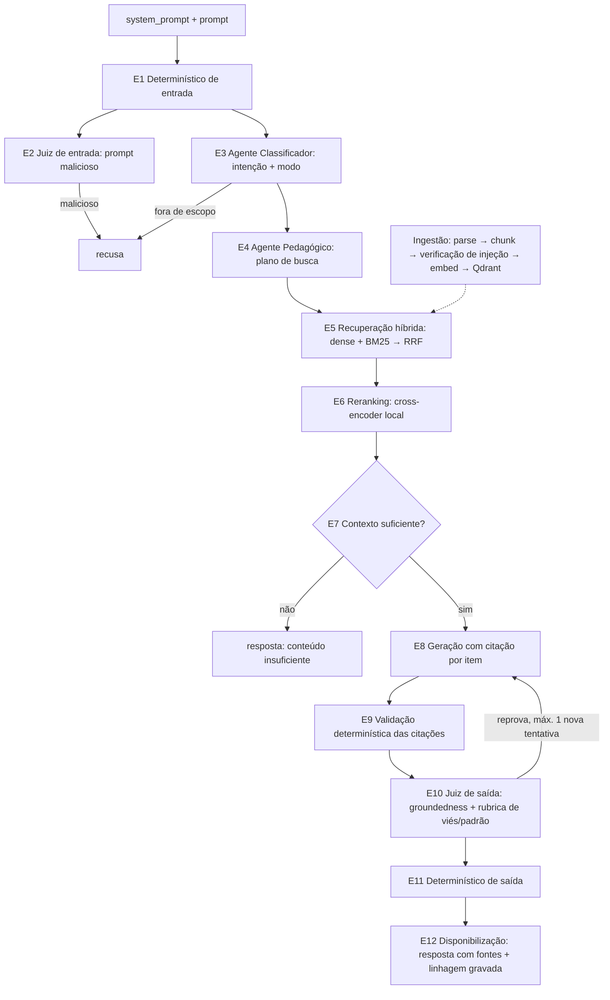
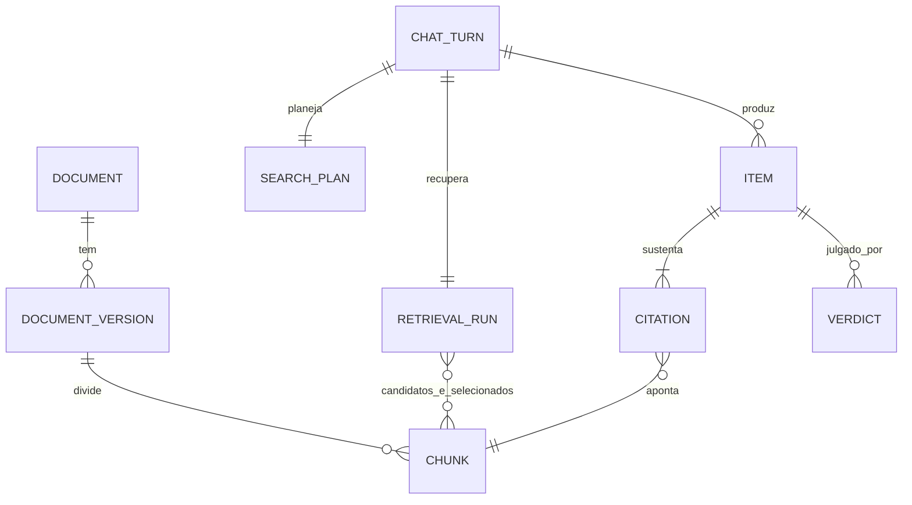
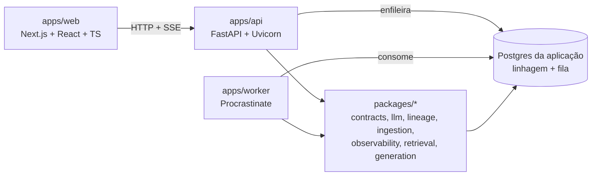

# Arquitetura da pipeline RAG — Training System

Estado: **Aceita** pelo humano em 2026-11-24        Interação: **chat** (pedido → resposta na hora)
Decisões: [0001](../adr/0001-orquestracao-adk-geracao-gemini.md) · [0002](../adr/0002-embeddings-qdrant-hibrido.md) · [0003](../adr/0003-reranker-cross-encoder-local.md) · [0004](../adr/0004-guardrails-e-juizes.md) · [0005](../adr/0005-observabilidade-langfuse-otel.md) · [0006](../adr/0006-avaliacao-ragas-litellm.md) · [0007](../adr/0007-monorepo-python-uv.md)

## 1. Objetivo

Gerar flashcards e questionários, via chat, a partir do material de estudo do usuário, com:

- todo item apontando para o trecho da fonte que o sustenta;
- toda requisição registrada como trace no Langfuse;
- verificação de que o item é sustentado pela fonte **antes** de ser entregue;
- recusa explícita quando o contexto não basta — nunca item inventado.

O sistema **não executa ações**: o modelo não tem ferramentas, não roda SQL, shell nem chama APIs externas. Isso define o modelo de ameaça (seção 5).

## 2. Fluxo de uma mensagem



E2 e E3 rodam **em paralelo**; se E2 reprovar, E3 e o que vier depois são cancelados.

| Etapa | Executor | Entrada → saída | Falha / bloqueio |
| --- | --- | --- | --- |
| **E1 Determinístico de entrada** | código | prompt → prompt normalizado | tamanho acima do limite, rate limit excedido → recusa com motivo |
| **E2 Juiz de entrada** | LLM `gemini-3.1-flash-lite` (AI Studio), saída estruturada | prompt → `{malicioso: bool, categoria, motivo}` | malicioso → recusa; erro do juiz → recusa (falha fechada) |
| **E3 Classificador** | agente ADK, `gemini-3.1-flash-lite`, saída estruturada | prompt → `{intencao, modo: cobertura \| consulta, escopo}` | `fora_de_escopo` → resposta sem RAG |
| **E4 Pedagógico** | agente ADK, saída estruturada | intenção + escopo → **plano de busca**: objetivos de aprendizagem, nível de Bloom, 1–3 consultas reescritas | — |
| **E5 Recuperação** | código, Qdrant | consultas do plano → 30–50 candidatos (união, sem duplicatas) | Qdrant fora → erro ao usuário, sem resposta alternativa |
| **E6 Reranking** | `BAAI/bge-reranker-v2-m3` local | candidatos → 5–10 melhores com score | — |
| **E7 Suficiência** | código: corte no score do reranker | top-N → segue ou para | nenhum candidato acima do corte → `conteúdo insuficiente`, zero itens |
| **E8 Geração** | agente ADK, `gemini-3.1-flash-lite` | contexto numerado + objetivos/Bloom do plano → itens com citações | JSON inválido → 1 nova tentativa |
| **E9 Validação determinística** | código | itens → aceitos/rejeitados com motivo | — |
| **E10 Juiz de saída** | LLM `anthropic/claude-haiku-5.5` (OpenRouter), **uma** chamada com duas rubricas | itens + chunks citados → veredito por item | reprovado → 1 nova tentativa só dos reprovados; persistindo, item omitido com motivo |
| **E11 Determinístico de saída** | código | itens → itens sanitizados e validados contra o schema | violação → item omitido |
| **E12 Disponibilização** | código | itens finais → resposta no chat com fontes; linhagem e `trace_id` gravados | falha ao gravar linhagem → a resposta não é entregue |

### 2.1 Modos de recuperação (decididos em E3)

- **Consulta** ("flashcards sobre fotossíntese"): E5 executa as consultas do plano de busca.
- **Cobertura** ("baralho do capítulo 3"): o escopo é uma seção inteira, não uma pergunta. Os chunks do escopo são percorridos em ordem de leitura e a quantidade de itens é distribuída proporcionalmente ao tamanho de cada subseção, para não concentrar os cards no começo. No chat, a quantidade por mensagem tem um teto, e a resposta oferece "gerar mais".

### 2.2 Contrato de saída da geração (E8)

O contexto chega numerado e delimitado como **dado**, nunca como instrução: `[C3] (p. 12, 2.3 Fase clara) …texto…`.

```text
Flashcard   front, back, bloom_level, citations[]
Question    stem, options[], correct_index, explanation, bloom_level, citations[]
Citation    chunk_ref ("C3"), evidence (trecho literal curto da fonte)
```

### 2.3 Validação determinística (E9)

| Regra | Rejeita quando |
| --- | --- |
| Integridade da citação | `chunk_ref` não estava no contexto, ou não há citação |
| Evidência literal | `evidence` normalizado (espaços, caixa, pontuação) não aparece no chunk citado |
| Questão bem formada | alternativas repetidas, `correct_index` fora do intervalo, menos de 2 alternativas |
| Duplicata | item quase idêntico a outro da mesma resposta |
| Vazio/trivial | campo vazio, frente igual ao verso |

## 3. Ingestão

Assíncrona, disparada pelo upload; cada etapa é idempotente.

1. **Receber**: valida tipo e tamanho e calcula o `sha256` do arquivo. O hash identifica a versão do documento.
2. **Parsear**: extrai texto preservando título, seção, tabela e número de página, com o Docling ([ADR-0009](../adr/0009-parser-docling.md)).
3. **Chunk**: respeita a estrutura do documento; um chunk não atravessa seção de nível 1. Cada chunk guarda `document_version_id`, página, `section_path` e offsets. `chunk_id` determinístico, derivado do conteúdo e da versão do chunker.
4. **Verificação de injeção indireta**: o conteúdo enviado pelo usuário é o principal vetor de injeção indireta (OWASP LLM01). Chunks com instruções direcionadas ao modelo são marcados e ficam fora da recuperação, com o motivo registrado.
5. **Embed**: `gemini-embedding-2`, 3072 dimensões, **uma requisição por chunk**. A API agrega várias entradas da mesma chamada num único vetor; volumes grandes vão pela Batch API. O modelo não aceita `task_type`, então a tarefa vai como prefixo no texto:
   - documento: `title: {titulo} — {section_path} | text: {chunk}`
   - consulta: `task: question answering | query: {consulta}`
6. **Indexar no Qdrant**: `upsert` por `chunk_id`, gravando o vetor denso (3072, cosseno) e o vetor esparso BM25 calculado pelo servidor, com **`language: portuguese`**. O padrão do Qdrant é inglês e degradaria a busca por palavra-chave.

A coleção é nomeada pela chave de embedding (`gemini-embedding-2@3072@fmt-v1`). Se a chave configurada divergir da coleção, a aplicação não sobe.

## 4. Recuperação e reranking

Uma chamada `query_points` ao Qdrant com dois `prefetch` (dense e BM25) e fusão por RRF, já filtrada por dono e documentos do escopo. O resultado (30–50 candidatos) vai para o cross-encoder, que devolve os 5–10 melhores. Os números de candidatos e de corte são valores iniciais: são ajustados pela latência medida (o chat é síncrono) e pelo RAGAS (ContextPrecision/Recall).

## 5. Guardrails

| Camada | O que faz | O que não faz |
| --- | --- | --- |
| E1 determinístico de entrada | limite de tamanho, normalização Unicode (NFKC), remoção de caracteres invisíveis, rate limit | **não filtra SQL nem shell**: não há onde executá-los, e o filtro bloquearia alunos estudando bancos de dados ou Linux |
| E2 juiz de entrada | detecta tentativa de manipular o modelo ou de extrair o system prompt | — |
| Ingestão, passo 4 | barra injeção indireta vinda dos documentos | — |
| Prompt da geração | contexto delimitado e marcado como dado; system prompt sem segredos (OWASP LLM07) | — |
| E9 + E10 | groundedness por item e rubrica de viés/padrão | — |
| E11 determinístico de saída | sanitização e escape para renderização web (OWASP LLM05: HTML/markdown/script dentro dos cards vira XSS), validação de schema | — |

A rubrica de viés/padrão do E10 é um documento versionado, mantido como prompt no Langfuse e aprovado pelo humano. Sem rubrica escrita, o juiz não tem critério reprodutível.

## 6. Modelos

| Papel | Modelo | Via | Restrição |
| --- | --- | --- | --- |
| Classificador, Pedagógico, Geração | `gemini-3.1-flash-lite` | AI Studio | — |
| Juiz de entrada | `gemini-3.1-flash-lite` | AI Studio | avalia o prompt do usuário, não a saída do Gemini; o viés de autopreferência não se aplica |
| Juiz de saída (chat) | `anthropic/claude-haiku-5.5` | OpenRouter | **não pode ser Gemini**; fica confirmado depois da calibração contra `openai/gpt-6-luna` (seção 9) |
| Juiz RAGAS (offline) | `openai/gpt-6.1-sol` | OpenRouter | terceiro provedor: audita também o juiz de saída |
| Embeddings | `gemini-embedding-2` @ 3072 | AI Studio | — |
| Reranker | `BAAI/bge-reranker-v2-m3` | local | Apache 2.0, multilíngue |

Todos os nomes de modelo vêm da configuração (variáveis de ambiente). As chamadas que não passam pelo ADK usam LiteLLM: o prefixo `gemini/` vai para o AI Studio e `openrouter/` para o OpenRouter.

## 7. Rastreabilidade



| Registro | Proveniência gravada |
| --- | --- |
| `document_version` | `sha256`, versão do parser |
| `chunk` | versão do chunker, página, seção, offsets; **imutável** |
| `chat_turn` | prompt, intenção, modo, veredito do E2, modelos e versões de prompt usados, `trace_id` |
| `search_plan` | objetivos, nível de Bloom, consultas reescritas |
| `retrieval_run` | candidatos com score de RRF e do reranker, selecionados, corte aplicado |
| `item` | conteúdo, status (entregue/omitido) e motivo |
| `citation` | `chunk_id`, evidência literal |
| `verdict` | origem (E9/E10), resultado, motivo, modelo juiz |

É possível navegar nos dois sentidos: **item → citação → chunk → página do documento**, e **item → `trace_id` → trace no Langfuse** (o trace leva o `chat_turn_id` nos metadados).

## 8. Observabilidade

- Cada mensagem gera um trace `chat_turn` no Langfuse, com um span por etapa (E1–E12). Os spans do ADK vêm do `openinference-instrumentation-google-adk`; os spans de código são manuais.
- O runner do ADK é chamado com `run_async`. A documentação avisa que `runner.run()` roda em outra thread e perde o contexto OpenTelemetry.
- Os prompts (classificador, pedagógico, geração, juízes, rubrica) ficam na gestão de prompts do Langfuse, com labels; cada span registra a versão usada.
- Scores no trace: veredito do E2, taxa de aprovação no E9 e no E10, RAGAS por amostragem e feedback do usuário ("card errado").
- Indisponibilidade do Langfuse não derruba o chat (a exportação é assíncrona). A linhagem da seção 7, ao contrário, é obrigatória (E12).

## 9. Avaliação

| Nível | Quando | O quê |
| --- | --- | --- |
| E9/E10 | toda mensagem | groundedness e rubrica, item a item |
| RAGAS offline | CI; e antes de trocar modelo, prompt, chunker ou parâmetro de recuperação | ContextPrecision/Recall (recuperação) e Faithfulness (item × chunks citados), sobre um dataset de referência revisado pelo humano |
| RAGAS online | amostra assíncrona das mensagens | mesmas métricas, como score no trace |
| Calibração dos juízes | antes de fixar o juiz de saída, e a cada troca de modelo ou rubrica | 50–100 itens rotulados à mão; fica o juiz com maior concordância |

O juiz do RAGAS é chamado via LiteLLM → OpenRouter. Sem `EVAL_JUDGE_MODEL` configurado, a avaliação não inicia: não existe juiz padrão. Os limiares saem da primeira execução (linha de base), passam por aprovação humana, e uma queda abaixo deles bloqueia o merge.

## 10. Aplicações e latência no chat

### 10.1 Aplicações

Monólito modular ([ADR-0010](../adr/0010-monolito-modular.md)): a regra de negócio fica nos pacotes de domínio (`packages/*`); as apps são adaptadores finos sobre eles. A dependência vai sempre de app para pacote, nunca o contrário. Um deploy e um banco da aplicação (ADR-0008), sem microserviços.



| App | Stack | Papel na arquitetura | ADR |
| --- | --- | --- | --- |
| `apps/api` | FastAPI assíncrono, servido por Uvicorn; ADK via `run_async` | recebe o chat, executa E1–E12, envia o progresso por SSE e o evento final com a `ChatResponse`; enfileira ingestão e avaliação; publica o OpenAPI | [0011](../adr/0011-api-fastapi-sse.md), [0014](../adr/0014-contratos-openapi.md) |
| `apps/worker` | Procrastinate sobre o Postgres da aplicação | executa a ingestão assíncrona (§3) e a avaliação online por amostragem (§9) como jobs duráveis | [0012](../adr/0012-fila-procrastinate-postgres.md) |
| `apps/web` | Next.js, React e TypeScript estrito; tipos gerados do OpenAPI | interface do chat; mostra o progresso e renderiza itens e fontes sempre escapados (RAG-SAI-001) | [0013](../adr/0013-front-nextjs-typescript.md) |

Contratos: o OpenAPI da `apps/api` é o artefato publicado dos modelos de `packages/contracts` que cruzam a fronteira HTTP ([ADR-0014](../adr/0014-contratos-openapi.md)). O JSON Schema exportado em `packages/contracts/schema/` continua até a mudança que criar a `apps/api`.

### 10.2 Latência no chat

- O caminho crítico tem quatro chamadas de LLM em série (E3 → E4 → E8 → E10) mais o reranker. O E2 corre em paralelo com o E3.
- Não há streaming do conteúdo: o item só pode aparecer depois do E10. O chat mostra o progresso por etapa ("entendendo", "buscando", "gerando", "verificando"), enviado por SSE com o buffering de proxy desligado; os itens chegam inteiros no evento final ([ADR-0011](../adr/0011-api-fastapi-sse.md)).
- O reparo é limitado a 1 nova tentativa. O orçamento de tempo por etapa será fixado depois da primeira medição ponta a ponta.

## 11. Decisões em aberto

| # | Decisão | Bloqueia |
| --- | --- | --- |
| 1 | ~~Onde gravar a linhagem da seção 7 (banco da aplicação)~~ **Resolvido**: Postgres da aplicação, separado do Langfuse ([ADR-0008](../adr/0008-linhagem-postgres.md)) | — |
| 2 | ~~Parser de documentos (precisa preservar página e seção)~~ **Resolvido**: Docling, para PDF, DOCX e Markdown ([ADR-0009](../adr/0009-parser-docling.md)) | — |
| 3 | Tamanho e sobreposição dos chunks | ingestão (inicial; ajustar por RAGAS) |
| 4 | ~~Como detectar injeção indireta na ingestão~~ **Resolvido** no G1 de `2026-11-24-ingestao`: heurística determinística em todo chunk e juiz LLM só nos suspeitos | ingestão, passo 4 |
| 5 | Lista fechada de intenções do E3 | E3 |
| 6 | Rubrica de viés/padrão do E10 | E10 |
| 7 | Calibração: Haiku 5.5 × GPT-6 Luna | E10 em produção |
| 8 | Mascaramento de conteúdo nos traces em produção | observabilidade |
| 9 | Quantos candidatos e qual corte (E5–E7), conforme latência medida | E5–E7 |
| 10 | ~~Estilo arquitetural, framework HTTP, entrega do progresso, fila de jobs, stack do front e publicação dos contratos~~ **Resolvido** no G1 de `2026-11-24-arquitetura-aplicacao`: monólito modular, FastAPI + Uvicorn com SSE, Procrastinate no Postgres da aplicação, Next.js + React + TypeScript, contratos pelo OpenAPI ([ADR-0010](../adr/0010-monolito-modular.md) a [ADR-0014](../adr/0014-contratos-openapi.md)) | — |
| 11 | Autenticação e identificação do usuário na API | mudança da `apps/api` |
